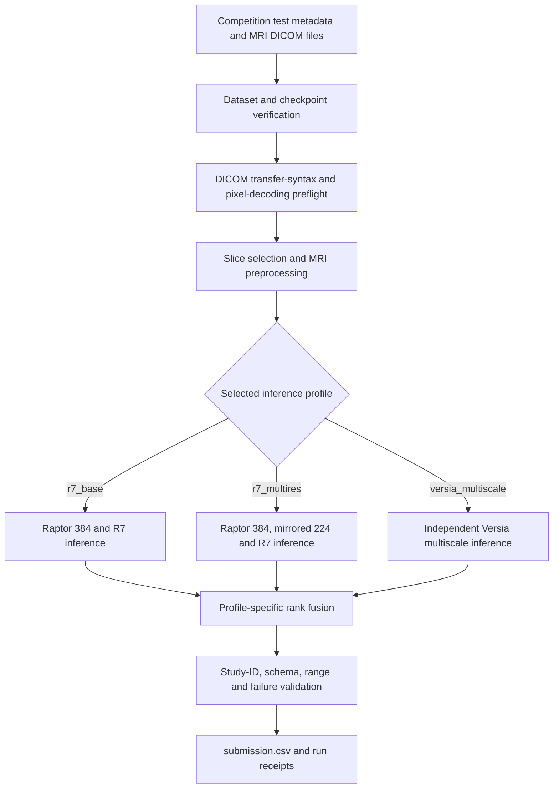

# RSNA Knee Abnormality Detection

Kaggle notebook project for **knee MRI abnormality prediction**, using pretrained deep-learning models, DICOM preprocessing, ensemble inference, and submission validation.

> **Status:** Work in progress. The unified notebook has undergone decoder-preflight fixes; a successful end-to-end Kaggle submission and leaderboard score have **not** been verified here.

## Project overview

This repository documents an inference-oriented workflow for the [RSNA Knee Abnormality Detection competition](https://www.kaggle.com/competitions/rsna-knee-abnormality-detection). It brings together ideas from several public Kaggle notebooks, with configurable inference profiles and checks intended to catch missing data, incompatible checkpoints, and invalid submissions.

### Features

- MRI series loading and preprocessing from DICOM images using `pydicom`.
- Pretrained-model inference on Kaggle GPUs, with offline execution.
- Configurable profiles: `r7_base`, `r7_multires`, and `versia_multiscale`.
- Ensemble prediction and submission-format validation.
- Transfer-syntax and pixel-decoding checks before inference.
- Runtime logs and provenance/validation receipts.

## Notebook

Main notebook: `rsna-knee-unified-decoder-fixed.ipynb` (rename the uploaded notebook to this filename if needed).

The notebook includes multiple alternative pipelines; **only the selected `PROFILE` is run**.

| Profile | Description |
| --- | --- |
| `r7_base` | Raptor-384 and R7 prediction blend; skips the optional 224 stage. |
| `r7_multires` | Raptor-384, 224-view inference, and R7 blend. |
| `versia_multiscale` | Separate multiscale ensemble path, not an additional blend with R7. |

The multiresolution notebook describes a rank-based ensemble of the Raptor and R7 outputs. Exact weights and processing details are documented in the notebook and should be checked before changing a profile.

## Analysis and workflow

### Source notebook analysis

The unified notebook reviews seven source notebooks and distinguishes reusable inference models from diagnostics and duplicated pipelines. Its R7 family uses Raptor-384, an optional anatomically mirrored 224-resolution branch, and an R7 four-fold ensemble. The independent Versia multiscale stack is selectable as a separate profile, not automatically blended into R7. The efficiency-leaderboard notebook is a viewer, not an MRI model; the B1 control notebook contributes decoder and validation checks rather than an executed 2.5D reader.

### Processing workflow



1. **Load inputs:** Read competition metadata and locate the corresponding MRI DICOM series and attached pretrained checkpoints.
2. **Preflight:** Verify the Kaggle/Linux runtime, required paths, source/checkpoint contracts, DICOM transfer syntaxes, and example pixel decoding. The decoder check does not require JPEG libraries for images already decodable with `pydicom`.
3. **Preprocess:** Construct the model-specific MRI representations. The optional 224 branch applies anatomy-aware mirroring rather than an unconditional flip.
4. **Run inference:** Execute only the selected profile, with separate processes/stages where specified to manage GPU memory and record failures.
5. **Fuse predictions:** Use the profile's established ranking and ensemble rules. For `r7_multires`, the documented recipe is `Raptor = 0.65 × rank(P384) + 0.35 × rank(P224)` followed by `Final = 0.50 × Raptor + 0.50 × rank(PR7)`, with average-tie percentile ranks and explicit handling of failed rows. Effective weights for a fully scored cohort are 32.5% / 17.5% / 50%. For `r7_base`, the 224 branch is omitted and the Raptor-384/R7 shares are 50%/50%.
6. **Validate and publish:** Check study identities and ordering, required columns, prediction ranges, nonconstant outputs, and configured failure thresholds. Write the final CSV only after validation and retain diagnostic receipts.

### Technical analysis and safeguards

- **Offline inference:** Model checkpoints and any necessary dependencies are attached as Kaggle datasets; the final inference run is intended to work with Internet disabled.
- **Decoder compatibility:** A successfully decoded 640×640 DICOM and a sample of 15 test series used uncompressed Explicit VR Little Endian (`1.2.840.10008.1.2.1`). The notebook's corrected preflight checks the actual data rather than requiring optional JPEG packages unconditionally.
- **Ensemble integrity:** Raptor-384 and Raptor-224 have separate success/failure tracking so unsuccessful 224 predictions cannot silently enter the blend.
- **Reproducibility:** The notebook tracks source/checkpoint provenance, stage logs, a global runtime budget, and final validation receipts.
- **Model scope:** This is a pretrained-model inference workflow, not a from-scratch training pipeline. Rank-based outputs should not be interpreted as calibrated clinical probabilities.

### Evaluation status

No successful end-to-end submission or independently verified competition score is established by the current project artifacts. Scores quoted in upstream notebook names are third-party claims and should not be presented as this repository's results. Runtime observed on a small visible test set does not establish hidden-test performance.

## Running on Kaggle

1. Open [Kaggle Notebooks](https://www.kaggle.com/code) and import the `.ipynb` file.
2. Attach the **RSNA Knee Abnormality Detection** competition dataset.
3. Attach the **specific pretrained checkpoint datasets required by your selected profile**. The notebook performs checkpoint/path verification; model weights are not included in this repository.
4. Enable a supported Kaggle GPU (the workflow has been configured for T4 GPUs).
5. Keep **Internet disabled** for the offline inference run.
6. Review the configuration cell, including `PROFILE`, runtime budget, and failure thresholds.
7. Run the notebook and inspect its logs and validation output.
8. Verify that `/kaggle/working/submission.csv` exists and matches the competition's required submission format before submitting.

### DICOM decoder note

A Kaggle test decoded an image with transfer syntax `1.2.840.10008.1.2.1` (Explicit VR Little Endian) using `pydicom`, and 15 sampled test series had that same uncompressed syntax. This does **not** prove that every DICOM file uses that syntax. The corrected preflight tests observed transfer syntaxes and example pixel decoding rather than requiring JPEG plugin installation unconditionally. Compressed images may still need compatible decoder packages.

## Suggested repository structure

```text
rsna-knee-abnormality-detection/
├── README.md
├── rsna-knee-unified-decoder-fixed.ipynb
└── .gitignore
```

Keep downloaded competition images, private labels, model checkpoints, logs, and generated submissions out of version control unless their respective licenses and competition rules explicitly allow redistribution.

## Technologies

Python, Jupyter Notebook, Kaggle, PyTorch, pandas, NumPy, pydicom, and deep-learning model components used by the selected notebook profile.

## Reproducibility and limitations

- Checkpoint datasets and Kaggle input mounts must be supplied separately.
- The workflow is designed for **inference**, not end-to-end training from scratch.
- A passing decoder preflight does not guarantee model loading, inference, or a valid submission.
- Reported scores or leaderboard rankings from upstream notebook titles are **not** results claimed for this repository.
- Predictions are for a research competition, **not clinical diagnosis**.

## Acknowledgements

The unified notebook draws on work from multiple Kaggle contributors, including **nartaa**, **heliosli**, and **dreaddevelopment**, and incorporates ideas from a separate Versia multiscale pipeline. Refer to the notebook's *Credits and required acknowledgement* section for the full source-specific attributions, research data acknowledgements, and upstream links.

Competition data: [RSNA Knee Abnormality Detection](https://www.kaggle.com/competitions/rsna-knee-abnormality-detection).

**Licensing:** Before adding an open-source license, verify permissions for any adapted notebook code, pretrained checkpoints, and dataset-derived materials. No permission to redistribute third-party assets is implied by this README.
